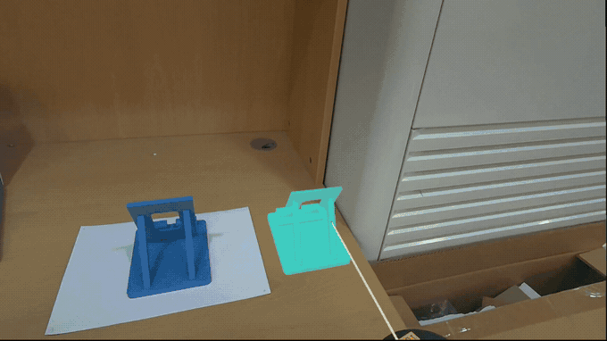
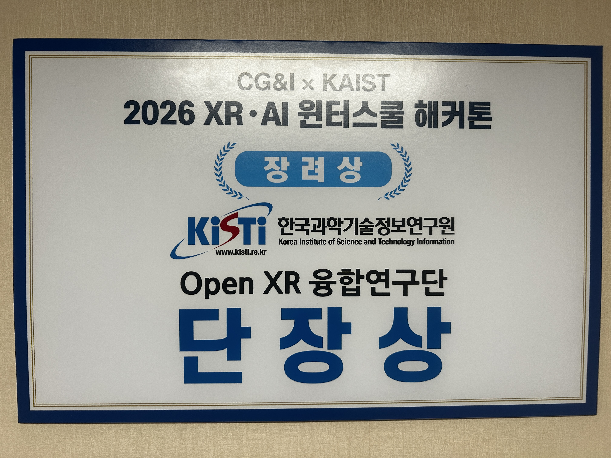
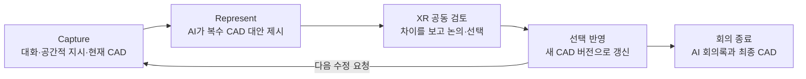
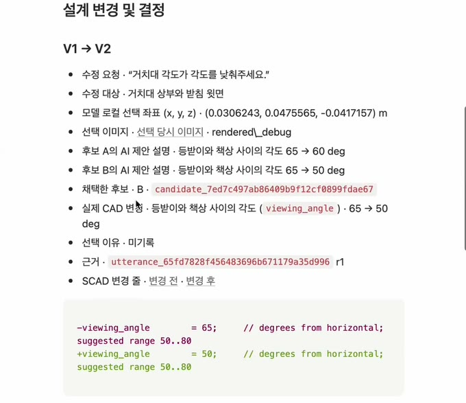
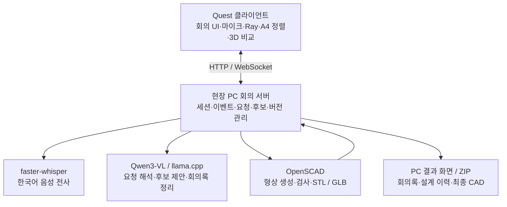

# FormBridge
카이스트 전기및전자공학부 **김찬이** & 전산학부 **이주영**

### 모호한 설계 피드백을, 함께 비교하고 선택할 수 있는 CAD 대안으로

**FormBridge는 AI가 설계 피드백을 여러 CAD 선택지로 구체화하고, 팀이 XR에서 직접 비교하며 더 나은 결정을 내리도록 돕는 설계 회의 프로토타입입니다.** 회의가 끝나면 논의와 선택 결과를 AI 회의록으로 정리하고, 실제 수정이 반영된 최종 CAD를 함께 제공합니다.

🏆 **2026 XR·AI 윈터스쿨 해커톤 장려상**<br>
**한국과학기술정보연구원(KISTI) Open XR 융합연구단 단장상** · CG&I × KAIST

[시연 영상](#시연-영상) · [아이디어와 효용](#왜-formbridge인가) · [실제 구현](#실제로-구현한-것) · [실행 가이드](docs/phone-stand-runbook.md) · [발표 자료](docs/presentation/FormBridge_Presentation.pptx)

## 시연 영상

<p align="center">
  
</p>

**[▶ 전체 시연 영상 다운로드 · MP4 · 약 58초](https://github.com/leejuyoung0918/contextpin-xr/raw/refs/heads/main/docs/media/formbridge-demo.mp4)**

실물 휴대폰 거치대를 책상 위에 놓고, 옆에 표시된 현재 CAD와 수정 후보를 비교하는 실제 Quest 시연입니다. 위 미리보기는 전체 시연 녹화에서 후보 비교 장면을 발췌했습니다. 전체 영상에서는 회의 화면, CAD 후보 비교, 회의 종료와 PC 결과 확인 흐름을 볼 수 있습니다.

> 공개 버전의 앱·패키지·소스 폴더에는 개발 당시 이름인 **ContextPin XR**이 남아 있습니다. **FormBridge**는 이 프로토타입의 최종 발표명입니다.

<details>
<summary><strong>수상 사진 보기</strong></summary>

<p align="center">
  
</p>

</details>

## 목차

- [왜 FormBridge인가](#왜-formbridge인가)
- [어떤 효용을 기대하는가](#어떤-효용을-기대하는가)
- [사용 흐름](#사용-흐름)
- [실제로 구현한 것](#실제로-구현한-것)
- [회의가 끝나면 무엇이 남는가](#회의가-끝나면-무엇이-남는가)
- [시스템 구성과 기술 스택](#시스템-구성과-기술-스택)
- [현장 PC와 Quest 실행](#현장-pc와-quest-실행)
- [검증 계획과 현재 한계](#검증-계획과-현재-한계)
- [향후 연구 방향](#향후-연구-방향)
- [문서와 참고문헌](#문서와-참고문헌)

## 왜 FormBridge인가

### 같은 말이 같은 형상을 뜻하지 않을 때

“손으로 동그라미를 만들어 주세요.”

누군가는 엄지와 검지를 맞대고, 누군가는 두 손을 둥글게 모읍니다. 같은 말을 들어도 머릿속에 그린 모습은 다릅니다. 설계 회의에서도 비슷한 일이 일어납니다.

> “등받이를 조금 더 눕혀 주세요.”<br>
> “이 부분을 조금 넓혀 주세요.”

이런 요청에는 바꿀 부위, 변경 방향, 변경 정도가 충분히 드러나지 않을 수 있습니다. 요청자는 자신이 원하는 모습을 떠올리고 있지만, 다른 팀원은 다른 형상을 상상할 수 있습니다. 말로는 이해했다고 생각해도, 실제 모델이 달라진 뒤에야 차이를 발견할 수 있습니다.

FormBridge는 이때 **AI가 가능한 해석을 구체적인 CAD 대안으로 제시하고, 사람이 차이를 보고 판단할 수 있게 하는 방법**에 주목했습니다.

### AI가 선택지를 만들고, 사람이 비교하며 결정하기

FormBridge에서 AI는 발화, 가리킨 위치, 현재 CAD를 함께 해석합니다. 허용된 설계 범위 안에서 서로 다른 수정안을 만들고, 팀은 XR에서 같은 실물·현재 모델·수정 후보를 보며 비교합니다.

예를 들어 “각도를 조금 줄여 주세요”라는 요청에 대해 변경 정도가 다른 두 CAD를 나란히 볼 수 있다면, 사용자는 어떤 변경 정도를 원하는지 더 구체적으로 설명할 수 있습니다.

핵심은 **선택 가능한 형상을 통해 모호함을 줄이고, 더 나은 설계 결정을 지원하는 것**입니다. 회의록은 이 과정의 논의와 선택 결과를 정리하고, 최종 CAD는 그 결정을 실제 형상으로 남깁니다.

### 기존 XR 협업에서 이어지는 질문

[Gravity Sketch](https://help.gravitysketch.com/collaboration)와 [Arkio](https://feedback.arkio.is/en/help/articles/360002027678-live-meetings)는 같은 공간에서 모델을 만들고 검토하는 XR 협업의 가능성을 보여줍니다. FormBridge는 그 협업 중에 나오는 **모호한 피드백을 어떻게 선택지로 구체화하고, 비교·선택·결과 정리까지 연결할 수 있을까**를 다룹니다.

관련 연구도 이 문제의식에 근거를 제공합니다.

- **Luck (2013)** 연구는 실제 다학제 설계 회의에서 모호함과 정보 부족이 대화에 얽혀 나타나며, 일부 오해가 해소되거나 후속 과제로 기록되지 않은 채 남는 사례를 분석했습니다. [논문](https://doi.org/10.1017/S089006041300005X)
- **Xu et al. (2025)** 연구는 학생 82명의 2인 설계 실험에서 텍스트만 제시한 경우보다 스케치·CAD 같은 시각 표현이 특히 설계 구조의 공동 이해를 돕는 결과를 보고했습니다. CAD가 스케치보다 더 우수하다는 가설은 지지되지 않았습니다. [논문](https://doi.org/10.1017/dsj.2025.10008)

이 연구들은 FormBridge의 출발점입니다. **복수 CAD 비교와 회의록이 실제로 얼마나 도움이 되는지는 FormBridge에서 별도로 검증해야 합니다.**

## 어떤 효용을 기대하는가

| 설계 회의에서 겪는 상황 | FormBridge의 접근 | 기대하는 효용 |
|---|---|---|
| “조금”, “넓게”, “더 눕혀서”를 서로 다르게 해석함 | 서로 다른 해석을 실제 CAD 후보로 제시 | 추상적인 표현을 보고 판단할 수 있는 선택지로 전환 |
| 말로 설명하는 부위와 상대가 이해한 부위가 다름 | 발화에 Ray로 선택한 표면과 현재 CAD 버전을 연결 | 무엇을 바꾸는지 함께 확인 |
| 한 가지 수정안만 보고 적절한지 판단하기 어려움 | 현재 모델과 여러 대안을 같은 책상 위에서 비교 | 변경 정도와 대안의 차이를 구체적으로 논의 |
| 수정 내용을 전달하고 CAD를 바꾸는 과정이 끊김 | 요청·후보 생성·검토·채택을 한 회의 흐름으로 연결 | 결정한 내용을 실제 CAD 버전에 반영 |
| 회의 뒤에 무엇을 논의하고 선택했는지 다시 정리해야 함 | 전체 대화와 실제 변경 기록으로 AI 회의록 생성 | 논의, 선택 결과, 미해결 사항을 함께 확인 |
| 회의 결과와 최종 모델이 따로 보관됨 | 회의록·설계 이력·최종 CAD를 함께 내보냄 | 회의 내용을 실제 후속 설계 작업에 연결 |

주요 사용 장면은 **소규모 제품·시제품 설계 검토**, **디자이너와 개발자의 협의**, **교육·팀 프로젝트의 공동 설계 회의**입니다. 위 효용은 프로토타입이 지향하는 가치이며, 시간 단축이나 정확도 향상 수치를 측정한 결과는 아직 없습니다.

## 사용 흐름

발표에서는 **Capture → Represent → Transfer**로 상호작용을 설명하고, **Verify**에서 효과 검증 계획을 제안했습니다.



### 1. Capture · 무엇을 바꾸려는지 함께 포착

회의 전체의 대화를 전사하면서, 수정 요청은 별도 구간으로 표시합니다. 사용자가 현재 CAD의 표면을 가리키면 발화와 함께 **선택 지점, Ray, 이미지, 모델 배치, 당시 CAD 버전**을 연결합니다.

“이 부분”이라는 말만 따로 처리하는 대신, **어떤 모델의 어느 부위를 가리키며 말했는지**를 수정 요청에 담습니다. 여기서 공간 정보는 컨트롤러와 모델의 좌표 정보입니다.

### 2. Represent · 모호한 피드백을 CAD 선택지로 구체화

로컬 AI가 요청과 선택 근거를 해석해 등록된 파라미터 안에서 수정안을 제안합니다. OpenSCAD가 실제 형상을 생성하고 검사한 뒤, XR에 현재 모델과 수정 후보를 표시합니다.

기본 데모에서는 **청록색 Latest**, **주황색 후보 A**, **보라색 후보 B**를 비교합니다. 후보 수는 요청과 형상 제약에 따라 줄어들 수 있으며, 해석이 어려운 경우에는 추가 설명이 필요합니다.

### 3. Transfer · 비교한 내용을 함께 이해하고 결과로 연결

현재 회의에서는 여러 사용자가 같은 위치의 모델과 후보를 보며 의견을 주고받습니다. 참가자는 수정 부위와 선호 후보를 표시하고, 진행자가 최종 채택합니다. 채택한 형상은 새로운 Latest가 되어 다음 수정의 기준이 됩니다.

회의가 끝나면 AI가 전체 논의와 선택 결과를 회의록으로 정리합니다. 최종 CAD와 변경 이력도 함께 제공해, 회의에서 결정한 내용을 이어서 확인하고 작업할 수 있게 합니다. 발표에서 제안한 후속 작업자에 대한 경험 전달은 이 기록을 활용하는 확장 가능성이며, 효과 검증은 향후 과제입니다.

### 4. Verify · 의도 이해와 결정 과정에 도움이 되는지 검증

복수 대안이 의도 이해와 합의에 주는 효과, 그리고 논의 과정이 포함된 회의록의 활용 효과를 각각 비교할 계획입니다. 구체적인 조건과 지표는 [검증 계획](#검증-계획과-현재-한계)에 정리했습니다.

## 실제로 구현한 것

### 휴대폰 거치대 설계 회의

공개 버전은 **파라미터형 휴대폰 거치대**를 대상으로 동작합니다. 실물 거치대와 현재 CAD를 책상 위에 놓고, 등받이 각도와 앞턱 높이를 차례로 바꾸는 흐름을 시연할 수 있습니다.

1. **회의 준비:** A4 네 모서리를 등록해 책상 위 공통 좌표를 만듭니다. 다른 Quest도 같은 회의 코드로 참가합니다.
2. **수정 요청:** 오른손 **B를 누른 채** “등받이 각도를 조금 줄여 주세요”라고 말하고 놓습니다.
3. **대상 지정:** 확정 전사를 확인하고, 현재 CAD에서 등받이를 Ray로 가리켜 **A**를 누릅니다.
4. **후보 비교:** 생성된 수정 후보를 현재 모델과 비교하며 논의합니다.
5. **채택:** 진행자가 원하는 후보에 **A**를 누르면 새 버전이 Latest 자리에 표시됩니다.
6. **다음 수정:** 새 버전을 기준으로 앞턱 높이 등 다른 수정 요청을 이어갑니다.
7. **회의 마무리:** 회의를 종료하고 PC에서 AI 회의록, 변경 이력, 최종 CAD를 확인·다운로드합니다.

자세한 버튼 조작과 발화 예시는 [실제 시연 대본](DEMO.md)에 있습니다.

### 여러 Quest가 같은 모델을 보는 방식

번호를 적은 A4를 공통 기준으로 사용합니다. 진행자가 자기 시점에서 **① 왼쪽 아래, ② 오른쪽 아래, ③ 오른쪽 위, ④ 왼쪽 위**에 번호를 적습니다. 모든 사용자는 서 있는 방향과 관계없이 **종이에 적힌 ①→②→③→④**를 같은 순서로 등록합니다. 서로 다른 추적 원점에서도 같은 책상 위치에 모델을 배치할 수 있습니다.

진행자는 **Grip**으로 Latest를 이동할 수 있습니다. 참가자가 가리킨 CAD 지점과 제안한 후보도 공유합니다. 후보 검토 중에는 이동과 새 수정 요청을 잠가 같은 기준에서 검토하도록 했습니다. 기기 추적이 어긋나면 A4를 다시 등록할 수 있습니다.

현재 프로토타입은 사용자가 기준점을 등록하는 수동 정렬 방법을 사용합니다. [좌표와 다중 기기 실행 상세](docs/phone-stand-runbook.md#두-quest로-같은-거치대-보기)

### 현재 지원하는 설계 변수

| 변수 | 바꾸는 부분 | 기본값 | 허용 범위 |
|---|---|---:|---:|
| `viewing_angle` | 등받이 각도 | 65° | 50–80° |
| `backrest_length` | 등받이 길이 | 132 mm | 118–145 mm |
| `backrest_width` | 등받이 너비 | 88 mm | 80–96 mm |
| `base_width` | 받침 너비 | 120 mm | 110–130 mm |
| `base_depth` | 받침 깊이 | 145 mm | 140–155 mm |
| `lip_height` | 앞턱 높이 | 15 mm | 10–22 mm |
| `charging_notch_width` | 충전 통로 너비 | 15 mm | 8–24 mm |

기본 모델의 전체 치수는 **너비 120 × 깊이 145 × 높이 약 127.9 mm**입니다. 등받이 각도 변경에 따른 지지대 위치 등 연결 관계는 SCAD 수식으로 유지합니다. [CAD 원본](backend/meeting/phone_stand/phone_stand_parametric.scad) · [범위와 형상 제약](backend/meeting/phone_stand/assembly.json)

### 구현 범위 요약

| 기능 | 공개 버전의 동작 |
|---|---|
| 회의 전체 전사 | 일반 대화와 후보 검토 중 대화를 하나의 음성 타임라인에 기록 |
| 수정 요청 구분 | B 홀드 구간의 발화와 당시 CAD 버전을 연결 |
| 공간적 대상 지정 | A로 선택한 표면 좌표·Ray·이미지·모델 자세 보존 |
| AI 후보 제안 | 발화와 시각·CAD 맥락을 로컬 모델이 함께 해석 |
| 실제 CAD 생성 | OpenSCAD로 SCAD·STL 생성, GLB로 XR 미리보기 제공 |
| 공동 검토 | 공통 A4 좌표, 공유 선택 지점, 참가자 제안, 진행자 채택 |
| 버전 반영 | 채택한 후보가 다음 CAD 버전이 되어 수정 누적 |
| AI 회의록 | 전체 전사와 실제 설계 기록을 바탕으로 논의·결정·미해결 사항 정리 |
| 결과 내보내기 | 회의록·전사·결정·버전 이력·최종 CAD를 ZIP으로 제공 |

## 회의가 끝나면 무엇이 남는가

회의 결과는 **읽을 수 있는 회의록**과 **실제로 바뀐 CAD**를 함께 확인할 수 있도록 구성했습니다. “수정하기로 했다”는 문장과 해당 수정이 반영된 파일을 연결합니다.

PC 결과 화면에서는 회의 요약, 선택 기록, 전체 전사, 최종 SCAD를 확인할 수 있습니다. 전체 결과 ZIP에는 최종 STL·GLB와 버전별 CAD도 포함됩니다. 최종 SCAD·STL은 후속 설계·출력 검토에 사용할 수 있습니다.

<p align="center">
  
</p>

**실제 출력 예시:** 시연 영상의 회의록에는 60°·50° 후보의 차이, 후보 B의 채택, 그리고 `viewing_angle`이 **65°에서 50°로 바뀐 실제 CAD 변경**이 함께 나타납니다. 논의와 선택이 어떤 형상으로 반영됐는지 확인할 수 있습니다.

### AI 회의록에 담는 내용

- 회의 목적과 주요 논의
- 수정 요청과 비교·선택 결과
- 실제 CAD 버전 사이의 파라미터 변경
- 발화에서 확인할 수 있는 판단 근거
- 미해결 사항과 다음 작업

CAD 변화와 채택 수치는 서버에 저장한 실제 기록에서 가져오고, AI는 관련 논의를 정리합니다. 선택 이유가 명시되지 않았으면 **미기록**으로 남깁니다. 진행자의 채택을 팀 전체의 합의로 자동 간주하지 않습니다.

### 결과 파일

| 파일·폴더 | 내용 |
|---|---|
| `minutes/minutes.md` | 사람이 읽는 AI 회의록 |
| `minutes/minutes.json` | 근거 발화 ID, 수정 요청, 결정과 CAD 버전 연결 |
| `transcript.txt`, `transcript.jsonl` | 시간순 확정 전사와 발화별 시각·출처·개정 |
| `edit_requests/`, `decisions.json` | 요청 원문, 선택 위치와 이미지, 후보와 채택 기록 |
| `design_history.json`, `adopted_versions/` | 원본부터 최종본까지의 설계 변경 이력과 CAD |
| `cad/final.scad` | 최종 수정 사항을 반영한 파라미터 CAD |
| `cad/final.stl`, `cad/preview.glb` | 최종 형상의 STL과 3D 미리보기 |
| `manifest.json` | 회의·버전·처리 상태와 파일별 크기·SHA-256 |

AI 회의록 생성에 실패해도 전사·결정 기록과 저장된 CAD를 보존합니다. 다운로드 절차와 파일 경로는 [결과물 안내](docs/phone-stand-runbook.md#결과-파일)에 정리했습니다.

## 시스템 구성과 기술 스택



| 계층 | 사용 기술 | 역할 |
|---|---|---|
| XR 앱 | Unity **6000.4.0f1**, C# | 공간 UI, 입력, 모델 배치와 공동 검토 |
| XR 연동 | Meta XR SDK Core·MRUK **209.0.0**, OpenXR **1.16.1** | Quest 기능과 XR 실행 |
| 3D 로딩 | glTFast **6.21.0** | 생성된 GLB를 Unity에 표시 |
| 회의 서버 | Python **3.11+**, FastAPI, Uvicorn, WebSocket | 회의 상태와 실시간 이벤트, API |
| 음성 전사 | faster-whisper **base** | 현장 PC에서 한국어 전사 |
| AI 추론 | Qwen3-VL-2B, llama.cpp | 발화·이미지·CAD 맥락 해석과 회의록 |
| CAD 처리 | OpenSCAD, 파라미터 모델, STL·GLB 변환 | 허용 범위 내 실제 형상 생성 |
| PC 화면 | HTML, CSS, JavaScript | 회의 참가, 모델 검토와 결과 확인 |

기본 실행 경로는 **현장 PC 로컬 추론**을 사용하며 외부 AI API 사용료는 발생하지 않습니다. 최초 설치에는 패키지와 모델 다운로드가 필요하고, 이후 실행에도 PC와 Quest 간 연결은 필요합니다.

### 코드 둘러보기

| 경로 | 담당하는 내용 |
|---|---|
| [`ContextPinRelay/Assets/ContextPin/Runtime/`](ContextPinRelay/Assets/ContextPin/Runtime/) | Quest 회의 UI, 음성·Ray 입력, 정렬·공유·후보 검토 |
| [`backend/meeting/coordinator.py`](backend/meeting/coordinator.py) | 음성 타임라인, 수정 요청과 회의 생명주기 |
| [`backend/meeting/bundle_interpretation.py`](backend/meeting/bundle_interpretation.py) | 발화·선택 이미지·기준 CAD의 통합 해석 |
| [`backend/meeting/openscad_geometry.py`](backend/meeting/openscad_geometry.py) | CAD 생성, 형상 제약 검사와 변환 |
| [`backend/meeting/paper_space.py`](backend/meeting/paper_space.py) | 공통 A4 좌표와 다중 기기 상태 |
| [`backend/meeting/minutes_generator.py`](backend/meeting/minutes_generator.py) | 근거 발화를 연결한 AI 회의록 생성 |
| [`backend/meeting/meeting_result.py`](backend/meeting/meeting_result.py) | 결과 고정, CAD·이력·회의록 ZIP 내보내기 |
| [`backend/meeting/web/`](backend/meeting/web/) | PC 회의·결과 화면 |
| [`scripts/relay.py`](scripts/relay.py) | 서버, Unity 빌드·배포·시뮬레이터·검사 명령 |

## 현장 PC와 Quest 실행

[최초 설치부터 두 Quest 연결까지의 전체 실행 가이드](docs/phone-stand-runbook.md)에서 환경 설치와 연결 절차를 확인할 수 있습니다. Python 환경, OpenSCAD, 로컬 음성·비전 모델, Unity Android Build Support를 준비한 뒤 저장소 루트에서 실행합니다.

```sh
# 현장 PC: 로컬 AI와 OpenSCAD가 준비된 환경
python3 scripts/relay.py server

# Quest 앱 빌드와 USB 설치
python3 scripts/relay.py build
python3 scripts/relay.py deploy
```

| 항목 | 기본값 |
|---|---|
| PC 회의 화면 | `http://127.0.0.1:8791/meeting/` |
| 로컬 비전 모델 | `http://127.0.0.1:18905/v1` |
| 회의 데이터 | `artifacts/phone-stand-live/` |
| Quest 앱 이름 | `ContextPin XR Phone Stand` |
| Android 패키지 | `org.contextpin.relay.phonestand` |
| 빌드 결과 | `builds/ContextPinPhoneStand.apk` |

USB·Wi-Fi 연결, 여러 Quest 설치, 모델 실행 옵션, 치수·좌표 변환, 시뮬레이터 절차는 [실행 가이드](docs/phone-stand-runbook.md)를 참고하세요. 기존 케이블 정리대 대본도 [DEMO.md](DEMO.md#기존-케이블-정리대-대본)에 남아 있습니다.

### 검증 실행

```sh
python3 scripts/relay.py test
```

서버 회귀 검사와 별도의 Unity·Meta XR Simulator 스모크 절차를 제공합니다. [검사와 시뮬레이터 실행](docs/phone-stand-runbook.md#검증-실행)은 CAD 채택, 음성 타임라인, 공통 좌표, 결과 ZIP을 확인하기 위한 기능 검증입니다. 아래 사용자 연구의 효과 측정과 구분합니다.

## 검증 계획과 현재 한계

### 두 가지 연구 가설

| 가설 | 비교 조건 | 측정할 지표 |
|---|---|---|
| **H1 · 모호함 해소**: 여러 CAD 대안을 시각화하면 설계 의도의 차이를 더 쉽게 발견하고 해소할 수 있을 것이다. | 단일 CAD 제시 / 복수 CAD 제시 | 의도 이해 정확도, 합의까지 걸린 시간 |
| **H2 · 기록의 활용**: 모호함을 해소한 과정과 판단 근거를 포함한 회의록이 이전 의도 이해와 후속 작업을 도울 것이다. | 해소 과정이 빠진 회의록 / 해소 과정과 판단 근거를 포함한 회의록 | 이전 설계 의도 이해, 후속 작업 수행 |

H1은 **대안 비교가 현재의 결정을 돕는지**, H2는 **그 과정을 정리한 회의록이 이후 작업에도 도움이 되는지**를 묻습니다. 두 가설 모두 발표에서 제안한 사용자 실험 계획이며, 현재 공개 자료에 사람 대상 성능 결과는 없습니다.

### 현재 프로토타입의 한계

- **지원 형상과 수정 범위:** 등록된 파라미터 CAD와 허용 범위를 중심으로 동작합니다. 임의의 CAD를 자유롭게 편집하는 범용 시스템은 아닙니다.
- **AI 해석의 불확실성:** 음성 전사와 대상·수정 정도의 해석이 틀릴 수 있습니다. 확정 전사와 후보를 사람이 확인해야 합니다.
- **후보의 적절성:** 형상 제약을 통과한 후보라도 사용자의 의도를 충분히 대표하지 못할 수 있습니다. 추가 설명과 검토가 필요합니다.
- **물리적 성능:** 형상 검사는 실제 출력 품질, 강도·하중, 실물 간섭 시험을 대신하지 않습니다.
- **공간 정렬:** 현재는 사용자가 A4 네 모서리를 직접 등록합니다. 등록 오차와 추적 상태의 영향을 받습니다.
- **음성·화자 구분:** 두 Quest가 참가해도 회의 마이크는 하나입니다. 버튼을 누른 요청자와 실제 발화자를 구분하며, 확인할 수 없는 화자는 비워 둡니다.
- **회의록의 근거 범위:** 기록되지 않은 이유를 AI가 복원하지 않습니다. 누락·실패 상태와 미기록 항목을 남깁니다.
- **효과의 검증:** 기능 구현과 수상 이력은 확인할 수 있지만, 의도 이해 향상·합의 시간 단축·후속 작업 성과는 추가 실험이 필요합니다.

## 향후 연구 방향

### 모호함을 더 잘 줄이는 선택지는 무엇인가

여러 후보를 보여주는 다음 단계로, **어떤 차이를 가진 선택지를 보여줘야 사용자의 의도가 더 명확해지는가**를 연구하려 합니다.

발표에서 제안한 방향은 다음과 같습니다.

1. CAD 제약을 만족하는 후보 풀을 준비합니다.
2. 수정 부위·방향·정도에 남은 불확실성을 표현합니다.
3. **기대 정보이득(Expected Information Gain, EIG)** 기준으로 유용한 수정 방향과 대안을 선택합니다.
4. 사용자의 응답에 따라 가능한 의도의 범위를 좁히고, 필요하면 다음 비교나 추가 질문을 제시합니다.

예를 들어 변경 정도가 모호하다면, 모양이 비슷한 후보만 반복해서 보여주기보다 응답을 통해 원하는 범위를 더 잘 구분할 수 있는 후보를 제시하는 방식입니다. 실제 사용자의 판단 방식, 비교 부담, 후보 생성 비용을 함께 고려해야 합니다.

이는 **발표에서 제안한 연구 방향**이며, 공개 `main`의 기본 후보 생성 방식에 대한 성능 주장이나 사용자 실험 결과가 아닙니다. 지원 모델 확장과 H1·H2 사용자 실험도 함께 진행할 과제입니다.

## 문서와 참고문헌

### 프로젝트 자료

| 자료 | 내용 |
|---|---|
| [전체 시연 영상](https://github.com/leejuyoung0918/contextpin-xr/raw/refs/heads/main/docs/media/formbridge-demo.mp4) | Quest 시연 전체 영상(MP4) |
| [발표 슬라이드](docs/presentation/FormBridge_Presentation.pptx) | FormBridge 아이디어, 상호작용, 가설과 향후 계획 |
| [발표문](docs/presentation/script.ko.md) | 발표에서 설명한 문제의식과 제안 흐름 |
| [실행 가이드](docs/phone-stand-runbook.md) | 환경 설치, 로컬 모델, Quest 배포·연결, 좌표·치수·결과·검사 |
| [시연 대본](DEMO.md) | 등받이 각도와 앞턱 높이를 순서대로 바꾸는 실제 조작 |
| [CAD 어셈블리 문서](docs/openscad-assembly.md) | OpenSCAD 기반 모델 구성과 처리 |
| [모델 어댑터 문서](docs/meeting-model-adapters.md) | 모델 등록과 확장 관련 구현 문서 |
| [수상 사진](docs/media/award-2026-xr-ai.jpg) | 2026 XR·AI 윈터스쿨 해커톤 장려상 |

### 참고문헌

1. Luck, R. (2013). *Articulating (mis)understanding across design discipline interfaces at a design team meeting.* AI EDAM, 27(2), 155–166. [DOI](https://doi.org/10.1017/S089006041300005X)
2. Xu, Z., Martelaro, N., & McComb, C. (2025). *Mind over modality? The impact of design representation on shared understanding in collaborative student engineering design.* Design Science, 11, e19. [DOI](https://doi.org/10.1017/dsj.2025.10008)
3. Gravity Sketch. *Collaboration.* [공식 문서](https://help.gravitysketch.com/collaboration)
4. Arkio. *Live meetings.* [공식 문서](https://feedback.arkio.is/en/help/articles/360002027678-live-meetings)
